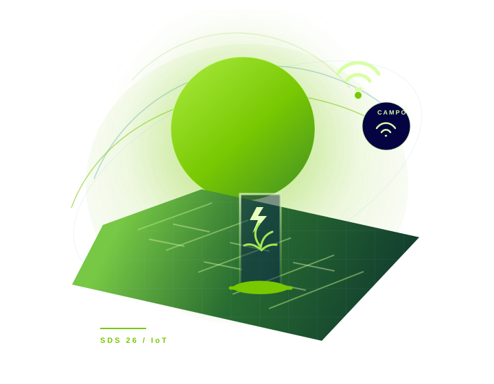

# Semana de Sistemas 2026 · Green IoT

Blog editorial y panel administrativo para documentar las actividades de la Semana de Sistemas 2026 de Ingeniería de Sistemas Informáticos, en la Facultad Multidisciplinaria Oriental de la Universidad de El Salvador.

   

<p align="center">
  
</p>

## El proyecto

El sitio reúne noticias, experiencias y evidencias de las actividades de la carrera. El público puede consultar las publicaciones disponibles y el programa de la semana; el equipo administrador puede organizar el contenido desde un panel protegido.


## Funciones

### Sitio público

- Inicio editorial y acceso al programa de la Semana de Sistemas 2026.
- Publicaciones visibles en orden cronológico, con categoría, fecha, portada y autoría.
- Búsqueda y filtro por categoría.
- Detalle de cada publicación con contenido, información propia de su actividad y galería.
- Páginas públicas de evidencias de Bryan y Osiris, agrupadas por actividad.
- Diseño adaptable a computadora y teléfono.

### Administración

- Inicio y cierre de sesión, con rutas administrativas protegidas.
- Panel con resumen de publicaciones publicadas, borradores y programadas.
- Crear, editar, programar y guardar borradores de publicaciones.
- Campos de contenido que cambian según la actividad: ponencias, talleres, feria de proyectos y actividades de convivencia.
- Gestión de categorías, portadas y hasta ocho imágenes adicionales por publicación.
- Carga y eliminación de evidencias individuales asociadas a una actividad publicada; cada cuenta administra solo sus fotos.
- Validación de formularios, mensajes de error y confirmaciones.

## Tecnologías

- Laravel 12 y PHP 8.2 o superior.
- PostgreSQL 16.
- Blade, CSS, JavaScript y Vite.
- Docker Compose para ejecutar PostgreSQL localmente.

## Preparación local

Los comandos siguientes asumen que tienes PHP, Composer, Node.js y npm instalados. En Windows con WSL, ejecútalos desde Ubuntu dentro de la carpeta del proyecto.

1. Instala las dependencias de PHP y JavaScript:

   ```bash
   composer install
   npm install
   ```

2. Crea la configuración local y genera la clave de Laravel:

   ```bash
   cp .env.example .env
   php artisan key:generate
   ```

   En PowerShell, usa `Copy-Item .env.example .env` en lugar de `cp`.

3. Inicia PostgreSQL:

   ```bash
   docker compose up -d db
   ```

   La configuración inicial usa el puerto `5433`, la base `sds26_db` y el usuario `postgres`. Si modificas esos valores en `.env`, Docker Compose también los usará al crear el contenedor.

4. Ejecuta migraciones y datos iniciales:

   ```bash
   php artisan migrate --seed
   ```

5. Compila los recursos y levanta Laravel:

   ```bash
   npm run build
   php artisan serve
   ```

   Abre [http://localhost:8000](http://localhost:8000). Para trabajar en los estilos mientras desarrollas, usa `npm run dev` en otra terminal.

## Rutas principales

| Página | Dirección |
| --- | --- |
| Inicio y publicaciones | `/` |
| Programa de la semana | `/semana-2026` |
| Evidencias de Bryan | `/evidencias/bryan` |
| Evidencias de Osiris | `/evidencias/osiris` |
| Acceso administrativo | `/iniciar-sesion` |
| Panel | `/admin` |
| Gestión de evidencias personales | `/admin/evidencias` |
| Publicaciones del panel | `/admin/publicaciones` |
| Categorías del panel | `/admin/categorias` |

## Imágenes y datos

Las imágenes cargadas se guardan dentro de `public/uploads` en el disco público de Laravel. Esa carpeta forma parte del proyecto para facilitar el traslado de sus archivos; los registros, categorías y usuarios se guardan en PostgreSQL. Al compartir o desplegar el sitio, conserva la carpeta de imágenes junto con el respaldo de la base de datos.

El seeder crea las categorías iniciales y las cuentas administradoras. Revisa `database/seeders/DatabaseSeeder.php` antes de usar el proyecto fuera del entorno local y cambia cualquier contraseña de demostración. No publiques `.env` ni claves reales en GitHub.

## Estructura relevante

```text
app/                     Modelos y controladores
database/migrations/     Estructura de PostgreSQL
database/seeders/        Datos iniciales
public/images/           Identidad visual y fotografías del equipo
public/uploads/          Imágenes de las publicaciones
resources/views/         Vistas Blade públicas y administrativas
resources/css/           Estilos del sitio
routes/web.php           Rutas públicas y del panel
```

## Equipo

- Osiris Ivania Andrade Campos
- Bryan Arturo Hernandez Gutierrez

Semana de Sistemas 2026 · Ingeniería de Sistemas Informáticos · FMO-UES
